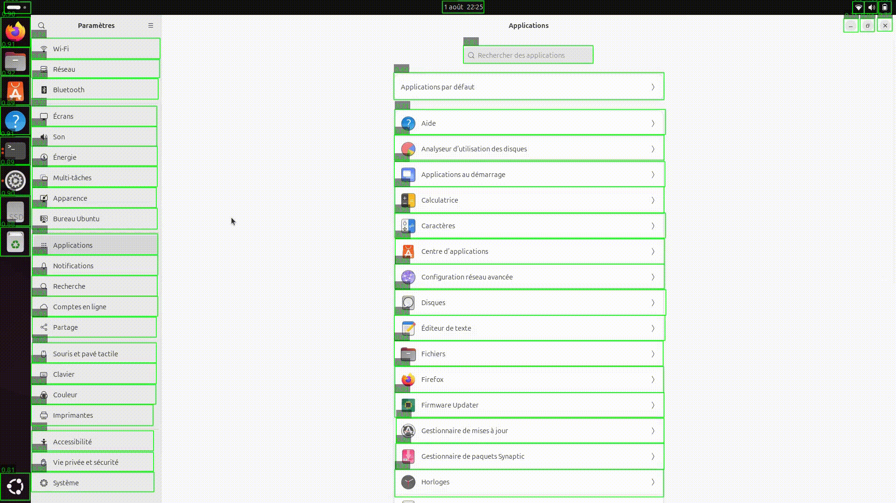
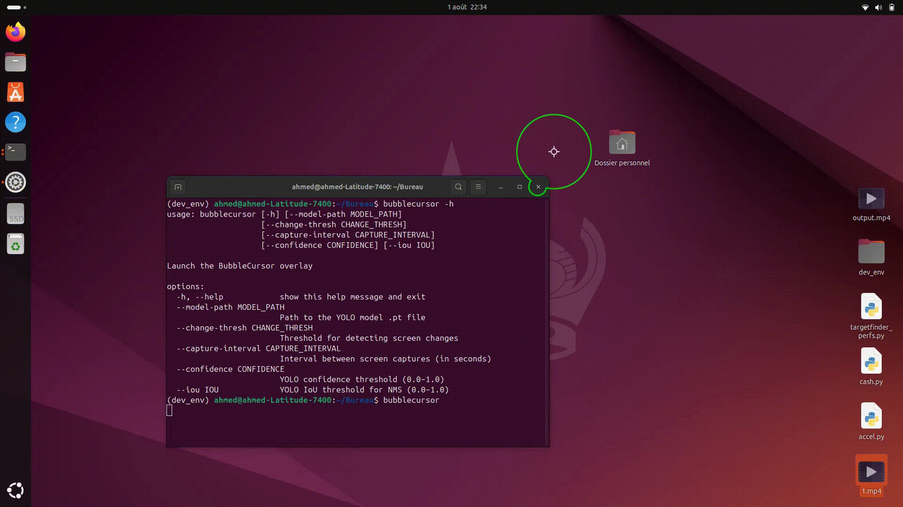
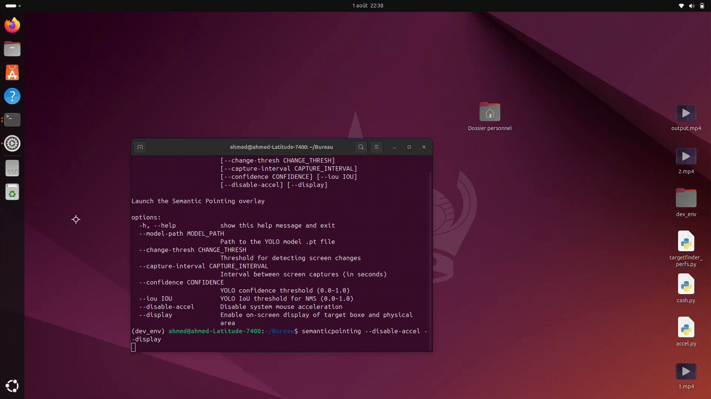

Using YOLOv8 + PyQt to build system-wide target facilitation techniques. Credits: Ahmed Ben Akouche, Julien Gori, Géry Casiez, Mathieu Nancel.

There are three demos below. The first shows TargetFinder, which is the tool that is performing real time desktop GUI widget detection, while the two reamining present two interaction techniques that exploit this information: Bubble Cursor, which is a dynamic area cursor that resizes to select the closest target, and Semantic Pointing, which makes widgets either "attractive" or "repulsive".

<!--more-->
